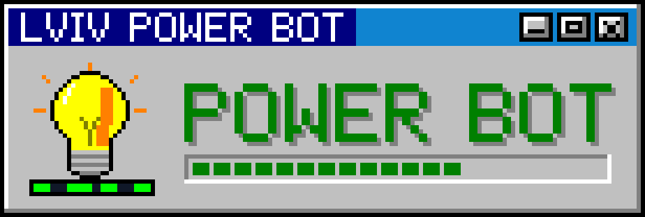

<p align="center">
  
</p>

<p align="center">
  <b>A Telegram bot that shows the Lvivoblenergo hourly outage schedules (ГПВ) for the addresses you track.</b><br>
  One picture, one news message, nothing else in the chat.
</p>

<p align="center">
  <code>Rust 2024</code> · <code>tokio</code> · <code>tiny-skia</code> · <code>Telegram Bot API</code> · <code>Lvivoblenergo</code>
</p>

---

## What it does

The chat always holds exactly **two** bot messages.

| Message | What is in it |
|---|---|
| **Card** | A rendered picture of the schedule for every tracked address: 24-hour bars for today and tomorrow. When there is no schedule, a celebrating frog. Its buttons are the whole interface: «➕ Слідкувати за адресою» and «📋 Мої адреси». Menus replace this message's caption and buttons instead of sending new messages. |
| **Info** | The latest news: a schedule appeared, was updated or cancelled, an outage is already running. On every change it is deleted and sent again, so Telegram notifies you. |

Every 5 minutes the bot fetches the schedule; the messages change only when the schedule did.

### Adding an address

громада (buttons) → населений пункт (buttons) → type `вулиця номер` (for example `Городоцька 171`) →
street / building / group buttons when the match is ambiguous → a name for the address.
Typed messages are deleted right away, so the chat stays clean.

### Being polite to the LOE servers

- All requests go through one gate: one at a time, at least 1.2 s apart, retried on 403 / 429 / 5xx.
- Look-ups are cached (a street's buildings: one request, kept 6 h).
- Extra clicks while an action runs get «Зачекай секунду…» instead of new requests.

## Data source

The same endpoints [poweron.loe.lviv.ua](https://poweron.loe.lviv.ua) uses itself:

- `api.loe.lviv.ua` menus `photo-grafic`: the schedules for today and tomorrow;
- `power-api.loe.lviv.ua` `pw_cities` / `pw_streets` / `pw_accounts`: the address look-up.

They are unofficial and undocumented and may change without notice.

## Run

1. Talk to [@BotFather](https://t.me/BotFather) → `/newbot` → copy the token. Use a new bot, not the Shahed bot's.
2. `cp .env.example .env` and fill it in:

   | Variable | Meaning |
   |---|---|
   | `TELEGRAM_BOT_TOKEN` | the token from BotFather |
   | `ALLOWED_CHAT_IDS` | optional: only these chats may use the bot |
   | `CHECK_SECS` | how often to fetch the schedule (default 300) |

3. Start it and write `/start` to the bot:

```bash
cargo run --release
```

`.env` is gitignored; never commit it. Chat state survives restarts (`cache/state.json`), so the bot keeps
editing the same two messages.

## Local checks without Telegram

```bash
cargo run --release -- --render out.png 1.1 5.1           # the current schedule for groups 1.1 and 5.1
cargo run --release -- --render-sample out.png 1.1        # the latest archived schedule
cargo run --release -- --resolve "Львів, Городоцька, 171" # address → group
cargo run --release -- --menu                             # the hromada / city order
```

## Layout

```
src/main.rs     the loop, the two-message chat logic, the local checks
src/loe.rs      Lvivoblenergo: schedules, address look-up, the request gate and its cache
src/ui.rs       the menu living inside the card: caption + buttons per step
src/render.rs   the cards: 24 h bars for today / tomorrow, the party frog
src/text.rs     text rendering (ab_glyph into a tiny-skia pixmap)
src/state.rs    per-chat state, persisted to cache/state.json
src/tg.rs       a tiny Telegram Bot API client (long polling, photos, edits, deletes)
docs/           logo.svg, banner.svg and make_logo.py that draws them
```

Related: [lviv-shahed-bot](https://github.com/andrii-claude-repos/lviv-shahed-bot) (air-raid maps) and
[lviv-status](https://github.com/andrii-claude-repos/lviv-status) (alerts and power in one macOS app).
